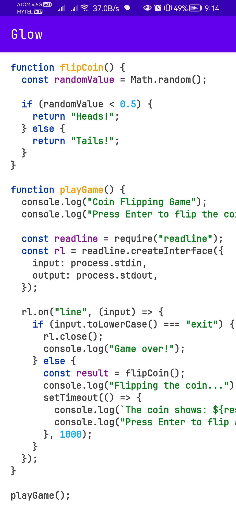

</img>

# glow 
A simple syntax highlighter to use with TextView. Kotlin, Java, JavaScript, and Python are Supported.

```kotlin
dependencies {
    implementation("com.naulian:glow:1.8.0")
}
```

```kotlin
val sourceCode = "print('hello')"
val language = "py" //or "python"

val highlighted = glowSyntax(sourceCode, language, CodeTheme.kotlinLight)
//textView.text = highlighted.raw 
textView.setCodeTheme(CodeTheme.kotlinLight.normal)
textView.text = highlighted.spanned

//compose
val annotatedHighLight = Glow.highlight(sourceCode, language, CodeTheme.kotlinLight)
Text(text= annotatedHighLight.value)
```
